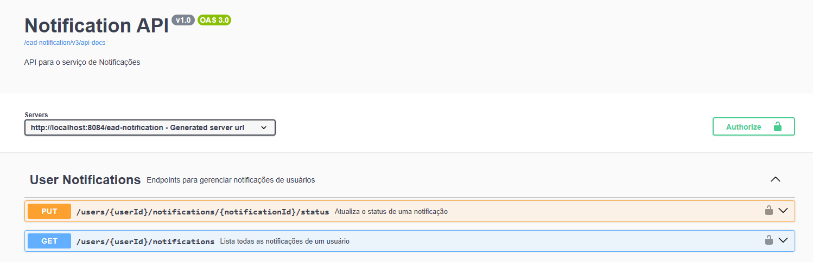

# Microserviço de Notificação (EAD)

Este projeto é um microserviço responsável pelo gerenciamento e envio de notificações para os usuários da plataforma EAD. Ele foi desenvolvido seguindo as melhores práticas de arquitetura de microsserviços, com uma API RESTful bem definida, segura e documentada.

## Tecnologias Utilizadas

- **Java 17**
- **Spring Boot 3.x**
- **Spring Data JPA**: Para persistência de dados.
- **Spring Security**: Para controle de acesso e autenticação via JWT.
- **Spring AMQP**: Para comunicação assíncrona com um broker de mensageria (ex: RabbitMQ).
- **PostgreSQL**: Como banco de dados relacional.
- **Springdoc OpenAPI 3 (Swagger)**: Para documentação interativa da API.
- **Maven**: Como gerenciador de dependências e build.

---

## Como Começar

Siga os passos abaixo para configurar e executar o projeto em seu ambiente local.

### Pré-requisitos

- **JDK 17** ou superior.
- **Maven 3.8+**.
- **Docker** (recomendado para instanciar o banco de dados e o message broker de forma rápida).


### Executando a Aplicação

1.  Clone o repositório para sua máquina local.
2.  Navegue até o diretório raiz do projeto.
3.  Execute o comando abaixo para iniciar a aplicação com o Maven:

    ```bash
    mvn spring-boot:run
    ```

A aplicação estará disponível em `http://localhost:8084/ead-notification`.

---

## Documentação da API (Swagger)

A API deste microserviço é documentada utilizando OpenAPI 3, com uma interface interativa fornecida pelo Swagger UI. Após iniciar a aplicação, você pode acessar a documentação no seguinte endereço:

*   **URL do Swagger UI:** **http://localhost:8084/ead-notification/swagger-ui.html**

Na interface do Swagger, você pode visualizar todos os endpoints, seus parâmetros, os corpos de requisição esperados e os possíveis códigos de resposta, além de poder testar os endpoints diretamente.



### Segurança

Todos os endpoints são protegidos e requerem um **Token JWT** válido, que deve ser enviado no cabeçalho `Authorization` como um Bearer Token.

Este Token deve ser gerado no MS-AUTH-USER no endpoint **'/ead-authuser/auth/login'**

```
Authorization: Bearer <seu-token-jwt>
```

---

## Padrão de Resposta de Erros

A API utiliza um padrão de resposta para erros, facilitando o tratamento no lado do cliente.

#### Erro Genérico / Não Encontrado (Ex: 404 NOT_FOUND)
```json
{
  "timestamp": "2026-11-02T21:00:00.000Z",
  "status": 404,
  "error": "Notificação não encontrada",
  "path": "/ead-notification/users/some-user-id/notifications/some-notification-id/status"
}
```

#### Erro de Validação (422 UNPROCESSABLE_ENTITY)
```json
{
  "timestamp": "2026-11-02T21:00:00.000Z",
  "status": 422,
  "error": "Dados inválidos",
  "path": "/ead-notification/users/some-user-id/notifications/some-notification-id/status",
  "errors": [
    {
      "fieldName": "notificationStatus",
      "message": "O status da notificação não pode ser nulo"
    }
  ]
}
```